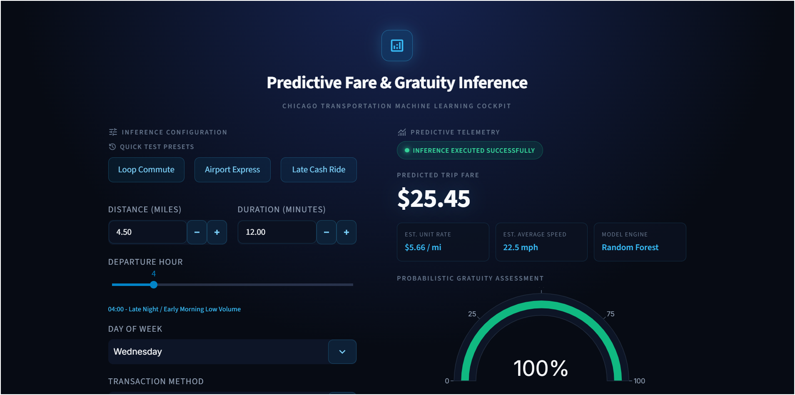
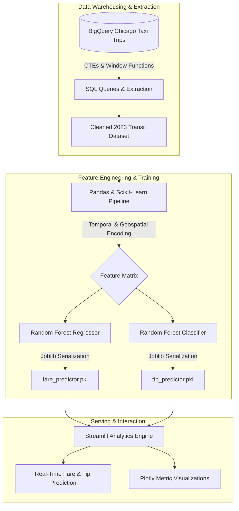

# Throwback on Internship Program
## Thrive Africa Internship: Ride-Share Demand & Predictive ML Analysis

[](https://www.python.org/)
[](https://cloud.google.com/bigquery)
[](https://scikit-learn.org/)
[](https://streamlit.io/)
[](https://datastudio.google.com/reporting/87045563-9634-4aae-b4be-f237db575605)

> Documentation for the end-to-end machine learning inference engine, data engineering pipeline, and business analytics system developed during the Thrive Africa Data Analytics & Data Science Internship.

---

## Executive Summary

This repository contains the complete technical deliverables, exploratory data analysis (EDA), predictive models, and deployment artifacts created during the **Thrive Africa Data Science Internship**.

Working as part of **Project 4 (Team 2)** ([Team Repository](https://github.com/data-analytics-internship-2026/project-4-team-2)), we addressed fare volatility, gratuity dynamics, and fleet operational efficiency using Chicago Transit data (`bigquery-public-data.chicago_taxi_trips`). This project covers the full analytics lifecycle: from BigQuery SQL warehousing and feature engineering to dual Random Forest model inference and an interactive Streamlit operational cockpit.

---

## Interactive Dashboard Preview

The Streamlit deployment provides real-time inference for both continuous fare regression and probabilistic tip classification, styled with a modern dark theme and radial glow aesthetics.



> **BI Dashboard:** The live Looker Studio Executive Report is accessible at [Looker Studio Report](https://datastudio.google.com/reporting/87045563-9634-4aae-b4be-f237db575605).

---

## System Architecture



---

## Deliverable Tracker

| Deliverable | Status | Component | Details |
| :--- | :---: | :--- | :--- |
| **SQL Data Extraction** | Completed | `sql-functions/` | Optimized BigQuery queries using CTEs, distance buckets, and tip rate aggregations. |
| **EDA Research** | Completed | `eda-notebooks/` | In-depth analysis of 2023 seasonal demand curves, payment patterns, and outliers. |
| **ML Training (Regression)** | Completed | `ml-notebooks/` | Random Forest Regressor predicting exact trip fare (**MAE: $2.78**). |
| **ML Training (Classification)**| Completed | `ml-notebooks/` | Random Forest Classifier predicting tip likelihood (**94% Accuracy**). |
| **Streamlit Web Application** | Completed | `app.py` & `.streamlit/` | Interactive prediction engine featuring instant multi-model inference. |
| **Executive Reports & Decks** | Completed | `reports/` & `presentations/` | Comprehensive stakeholder analytical report and presentation deck. |

---

## Machine Learning Performance

Dual machine learning models were developed to capture non-linear relationships, rush hour surcharges, and payment behavior:

| Model Objective | Target Variable | Algorithm | Key Metric | Business Impact |
| :--- | :--- | :--- | :--- | :--- |
| **Fare Estimation** | `fare` (USD) | Random Forest Regressor | **MAE: $2.78** | Transparent, predictable trip estimates across fluctuating congestion periods. |
| **Tip Likelihood** | `has_tip` (Binary) | Random Forest Classifier | **Accuracy: 94%** | Helps drivers identify high-gratuity routes and credit card payment trends. |

---

## Key Architectural & Tooling Decisions

* **Google BigQuery**: Utilized for scalable querying of millions of trip records using partitioned filters and window functions (`_cte.sql`, `_advanced.sql`).
* **Scikit-Learn (Random Forest)**: Chosen over linear baselines to model complex interactions between pickup location, time of day, and trip distance without severe overfitting.
* **Joblib Serialization**: Selected over standard `pickle` for significantly faster serialization and deserialization of ensemble tree structures.
* **Streamlit**: Selected for rapid deployment of an interactive analytics interface, bridging data science with operational tooling without requiring a separate JavaScript stack.

---

## Getting Started & Local Reproduction

### Prerequisites
- Python 3.10 or higher
- Git

### Installation Steps

1. **Clone the repository:**
   ```bash
   git clone https://github.com/data-analytics-internship-2026/project-4-team-2.git
   cd chicago-taxi-ml
   ```

2. **Create and activate a virtual environment:**
   ```bash
   python -m venv venv
   # On Windows (PowerShell):
   .\venv\Scripts\Activate.ps1
   # On macOS/Linux:
   source venv/bin/activate
   ```

3. **Install the required dependencies:**
   ```bash
   pip install streamlit joblib plotly scikit-learn pandas
   ```

4. **Launch the Streamlit Analytics Application:**
   ```bash
   streamlit run app.py
   ```
   *The application will automatically open in your default browser at `http://localhost:8501`.*

---

## Repository Structure

```text
chicago-taxi-ml/
├── .streamlit/
│   ├── app.py             # Streamlit application UI and logic
│   ├── config.toml        # Theme configuration
│   ├── dashboard.png      # Application interface preview
│   ├── fare_predictor.pkl # Serialized Random Forest Regressor
│   └── tip_predictor.pkl  # Serialized Random Forest Classifier
├── data/                  # Sample and processed dataset references
├── eda-notebooks/         # Exploratory data analysis Jupyter notebooks
├── ml-notebooks/          # Model engineering and training notebooks
├── presentations/         # Stakeholder presentation deck
├── reports/               # Analytical reports and dashboard documentation
├── sql-functions/         # BigQuery SQL CTEs and analytics queries
├── app.py                 # Application launcher
├── known_issues.md        # Technical tracking and deployment notes
└── README.md              # Master project documentation
```

---

## Notes & Known Issues

For details regarding Git LFS file handling and cloud hosting next steps, refer to [known_issues.md](known_issues.md).

---

## Continuous Learning & Growth

Through the **Thrive Africa Internship Program**, key competencies mastered include:
* End-to-end data pipelines from cloud data warehousing (BigQuery) to production ML serving.
* Advanced feature engineering for temporal transit patterns.
* Translating technical machine learning outcomes into executive business recommendations.
* Collaborative Git/GitHub workflows within cross-functional teams.

---

## Acknowledgments & Team

* **Organization:** [Thrive Africa](https://thriveafrica.co/) - Data Analytics & Data Science Internship
* **Team:** Project 4 Team 2 ([Team Repository](https://github.com/data-analytics-internship-2026/project-4-team-2))
