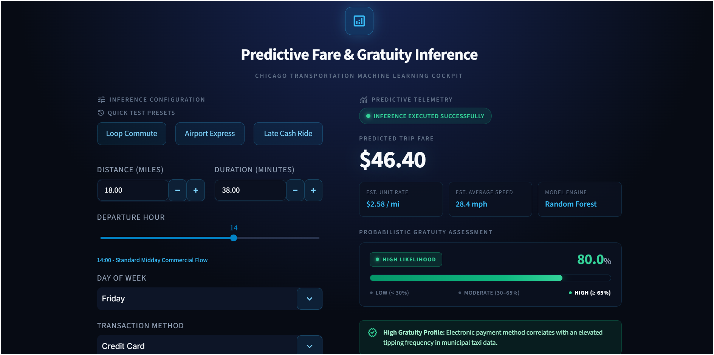
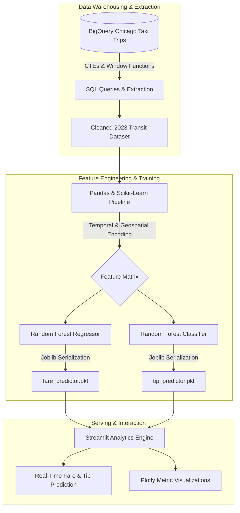

# Chicago Transit Demand Analysis & Predictive Machine Learning Platform
## Ride-Share Demand Optimization, BigQuery Engineering & Predictive ML Inference

[](https://www.python.org/)
[](https://cloud.google.com/bigquery)
[](https://scikit-learn.org/)
[](https://streamlit.io/)
[](https://datastudio.google.com/reporting/87045563-9634-4aae-b4be-f237db575605)

> Comprehensive technical documentation for the end-to-end machine learning inference engine, data engineering pipeline, and business analytics platform developed during the Thrive Africa Data Analytics & Data Science program.

---

## Executive Summary

This repository contains the complete technical deliverables, exploratory data analysis (EDA), predictive models, and deployment artifacts for municipal ride-share demand optimization.

Developed as part of **Project 4 (Team 2)** ([Team Repository](https://github.com/data-analytics-internship-2026/project-4-team-2)), this project addresses municipal fare volatility, gratuity dynamics, and fleet operational efficiency using Chicago Transit data (`bigquery-public-data.chicago_taxi_trips`). This project covers the full analytics lifecycle: from BigQuery SQL warehousing and feature engineering to dual Random Forest model inference and an interactive Streamlit operational cockpit.

---

## Interactive Dashboard Preview

The Streamlit deployment provides real-time inference for both continuous fare regression and probabilistic tip classification, styled with a modern dark theme and radial glow aesthetics.



> **BI Dashboard:** The live Looker Studio Executive Report is accessible at [Looker Studio Report](https://datastudio.google.com/reporting/87045563-9634-4aae-b4be-f237db575605).

---

## System Architecture



---

## Deliverable Tracker

| Deliverable | Status | Component | Details |
| :--- | :---: | :--- | :--- |
| **SQL Data Extraction** | Completed | `sql/` | Optimized BigQuery queries using CTEs, distance buckets, and tip rate aggregations. |
| **EDA Research** | Completed | `notebooks/` | In-depth analysis of 2023 seasonal demand curves, payment patterns, and outliers. |
| **ML Training (Regression)** | Completed | `notebooks/` | Random Forest Regressor predicting exact trip fare (**MAE: $2.78**). |
| **ML Training (Classification)**| Completed | `notebooks/` | Random Forest Classifier predicting tip likelihood (**94% Accuracy**). |
| **Streamlit Web Application** | Completed | `app.py` & `models/` | Interactive prediction engine featuring instant multi-model inference. |
| **Executive Reports & Decks** | Completed | `reports/` & `presentations/` | Comprehensive stakeholder analytical report and presentation deck. |

---

## Machine Learning Performance

Dual machine learning models were developed to capture non-linear relationships, rush hour surcharges, and payment behavior:

| Model Objective | Target Variable | Algorithm | Key Metric | Business Impact |
| :--- | :--- | :--- | :--- | :--- |
| **Fare Estimation** | `fare` (USD) | Random Forest Regressor | **MAE: $2.78** | Transparent, predictable trip estimates across fluctuating congestion periods. |
| **Tip Likelihood** | `has_tip` (Binary) | Random Forest Classifier | **Accuracy: 94%** | Helps drivers identify high-gratuity routes and credit card payment trends. |

---

## Key Architectural & Tooling Decisions

* **Google BigQuery**: Utilized for scalable querying of millions of trip records using partitioned filters and window functions (`04_distance_buckets_and_tips.sql`, `07_trip_classification_cte.sql`).
* **Scikit-Learn (Random Forest)**: Chosen over linear baselines to model complex interactions between pickup location, time of day, and trip distance without severe overfitting.
* **Joblib Serialization**: Selected over standard `pickle` for significantly faster serialization and deserialization of ensemble tree structures.
* **Streamlit**: Selected for rapid deployment of an interactive analytics interface, bridging data science with operational tooling without requiring a separate JavaScript stack.

---

## Getting Started & Local Reproduction

### Prerequisites
- Python 3.10 or higher
- Git

### Installation Steps

1. **Clone the repository:**
   ```bash
   git clone https://github.com/data-analytics-internship-2026/project-4-team-2.git
   cd chicago-taxi-ml
   ```

2. **Create and activate a virtual environment:**
   ```bash
   python -m venv venv
   # On Windows (PowerShell):
   .\venv\Scripts\Activate.ps1
   # On macOS/Linux:
   source venv/bin/activate
   ```

3. **Install the required dependencies:**
   ```bash
   pip install -r requirements.txt
   ```

4. **Launch the Streamlit Analytics Application:**
   ```bash
   streamlit run app.py
   ```
   *The application will automatically open in your default browser at `http://localhost:8501`.*

---

## Repository Structure

```text
chicago-taxi-ml/
├── .streamlit/
│   └── config.toml                  # Streamlit theme & UI configuration
├── assets/
│   └── dashboard_preview.png        # Production interface preview
├── data/
│   └── data_dictionary.md           # Dataset schema & feature definitions
├── models/
│   ├── fare_predictor.pkl           # Serialized Random Forest Regressor
│   └── tip_predictor.pkl            # Serialized Random Forest Classifier
├── notebooks/
│   ├── 01_data_extraction_inspection.ipynb # Initial BigQuery schema validation
│   ├── 02_exploratory_demand_analysis.ipynb # 2023 demand & pricing EDA
│   └── 03_fare_and_tip_ml_pipeline.ipynb   # Dual ML modeling & evaluation
├── presentations/
│   ├── README.md                    # Presentation deck overview
│   └── chicago_taxi_optimization_strategy.pdf # Executive stakeholder presentation
├── reports/
│   ├── analytical_report.pdf        # In-depth technical report
│   └── dashboard_specification.md   # Looker Studio deployment specs
├── sql/
│   ├── 01_initial_schema_validation.sql # Schema exploration query
│   ├── 02_stratified_eda_sample.sql     # Stratified BigQuery sampling
│   ├── 03_temporal_aggregations.sql     # Hourly & weekly volume aggregations
│   ├── 04_distance_buckets_and_tips.sql # Mileage buckets & tip dynamics
│   ├── 05_peak_hourly_revenue_rank.sql  # RANK window function analysis
│   ├── 06_time_series_mom_lag.sql       # LAG window month-over-month trends
│   └── 07_trip_classification_cte.sql   # Distance classification CTE
├── app.py                           # Core Streamlit application entry point
├── known_issues.md                  # System constraints & RCA logs
├── requirements.txt                 # Pinned project dependencies
└── README.md                        # Master repository documentation
```

---

## Notes & Known Issues

For details regarding Git LFS file handling and cloud hosting next steps, refer to [known_issues.md](known_issues.md).

---

## Technical Competencies & Engineering Scope

Key technical competencies and engineering practices demonstrated across this project include:
* **Cloud Data Warehousing & SQL Optimization:** Advanced partitioning, window functions, and Common Table Expressions (CTEs) within Google BigQuery.
* **Feature Engineering & Preprocessing:** Extraction of cyclic and categorical temporal features for urban transit modeling.
* **Supervised Machine Learning:** Training, hyperparameter configuration, and validation of ensemble regression and classification models using Scikit-Learn.
* **Model Deployment & Operationalization:** Production-grade model serialization via Joblib and low-latency interactive serving via Streamlit.
* **Executive Communication:** Synthesis of complex quantitative models into stakeholder dashboards and actionable business strategies.

---

## Acknowledgments & Team

* **Organization:** [Thrive Africa](https://thriveafrica.co/) - Data Analytics & Data Science Internship
* **Team:** Project 4 Team 2 ([Team Repository](https://github.com/data-analytics-internship-2026/project-4-team-2))
