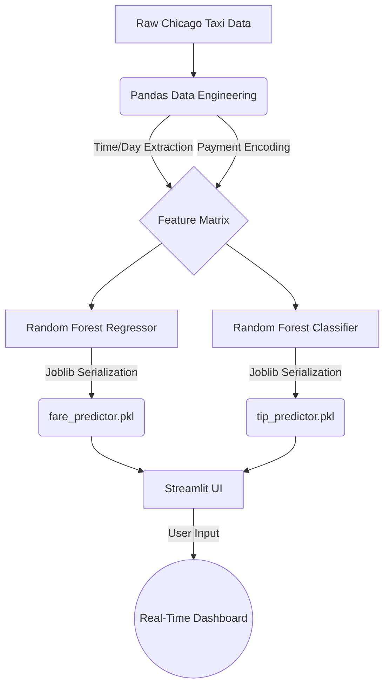

# Throwback on Internship Program
## Thrive Africa Internship: Ride-Share Demand & Predictive ML Analysis

**Documentation for the machine learning inference engine and data engineering pipeline developed during the Thrive Africa Data Analytics Internship.**

This repository contains the exploratory data analysis (EDA), feature engineering, and Streamlit deployment plans for a Chicago taxi fare and gratuity prediction system.

🔭 **What I worked on:**
* **Data Science Internship @ Thrive Africa:** Collaborated on [a ride-share demand analysis project](https://github.com/data-analytics-internship-2026/project-4-team-2).
* **Predictive Modeling:** Engineered time and payment features to build a Random Forest Regressor for exact fare prediction (MAE: $2.78) and a Random Forest Classifier for tip prediction (Accuracy: 94%).

## 📁 Repo Structure

```text
📦 internship-retro
 ┣ 📂 .streamlit           # Streamlit configuration files
 ┣ 📂 data                 # Raw and cleaned Chicago taxi datasets
 ┣ 📂 eda-notebooks        # Jupyter notebooks for exploratory data analysis
 ┣ 📂 ml-notebooks         # Model training (Random Forest Regressor & Classifier)
 ┣ 📂 presentations        # Slide decks and project reports
 ┣ 📂 sql-functions        # CTEs and query scripts for data extraction
 ┣ 📜 app.py               # Main Streamlit application script
 ┣ 📜 fare_predictor.pkl   # Serialized ML model (Regression)
 ┣ 📜 tip_predictor.pkl    # Serialized ML model (Classification)
 ┗ 📜 README.md            # Project documentation
 ```
## Deliverable Tracker

 | Deliverable | Status | Details |
 |-------------|--------|---------|
|EDA Research| ✅ Completed | Missing values cleaned, time features engineered |
| SQL Data Extraction | ✅ Completed | Create_cte.sql utilized for initial data pulls |
| ML Training | ✅ Completed |Fare Regressor | (MAE: $2.78) & Tip Classifier (Acc: 94%) |
| Streamlit UI | ✅ Completed | Live interactive dashboard deployed locally |
|GitHub Push | ✅ Completed | Codebase and models version-controlled |

## Tool Decisions
**Python & Pandas**: Chosen for robust data manipulation and feature engineering.

**Scikit-Learn (Random Forest)**: Selected for its ability to handle non-linear relationships in transit data (like rush hour spikes and weekend trends).

**Streamlit**: Enabled rapid deployment of Python scripts into a live, interactive frontend web application without needing full-stack JavaScript frameworks.

**Joblib**: Used over Pickle for faster serialization of large Random Forest .pkl files.


## 🏗️ System Architecture




